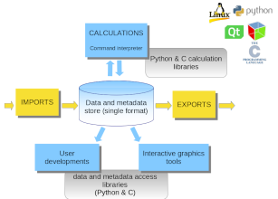

# AIDA 

**A software package for atmospheric data analysis, interpretation, and FAIR data production**

⚠️ **This repository contains a restricted version of AIDA as of 1 July 2024.**

AIDA is compliant with the following standards and libraries:
- [UDUNITS-2](http://www.unidata.ucar.edu/software/udunits) (UNIDATA's UDUNITS-2 package)
- [NetCDF](https://www.unidata.ucar.edu/software/netcdf/index.html) (UNIDATA's NetCDF library)
- [CF Conventions](https://cfconventions.org/Data/cf-conventions/cf-conventions-1.10/cf-conventions.html) for climate and forecast metadata
- [ESIP ACDD](https://wiki.esipfed.org/Attribute_Convention_for_Data_Discovery_1-3) (Earth Science Information Partners - Attribute Convention for Data Discovery)

**Tested on:** Ubuntu 22.04 LTS

---

## Installation

AIDA is **validated for Ubuntu 22.04 LTS** and **requires Python 3.10**.


### Dependencies

#### Ubuntu packages
The following Ubuntu packages are required:
```bash
sudo apt install -y meld xterm git gfortran rsync xutils-dev udunits-bin \
libudunits2-dev libnetcdf-dev libpython3-dev libgsl-dev libsqlite3-dev \
ncview graphviz gir1.2-webkit2-4.0 \
python3-qtpy python3-pyqt5.qtwebengine python3-pyqtgraph \
python3-folium python3-fiona python3-cartopy \
python3-netcdf4 python3-pandas \
python3-sphinx \
python3-xarray python3-pip


#### pip packages
Install the following pip package:
```bash
pip3 install cfunits==3.3.4 --no-deps --user
```

### Get and compile code
```bash
git clone <repository_url> aida
cd aida
./install
```

---

## Documentations
PDF documentation is available in the `aida/doc` directory.

To compile the documentation from source (located in `src/doc`), install the following packages:
```bash
sudo apt install doxygen texlive texlive-lang-french texlive-latex-extra
```
Then, run:
```bash
cd aida/src/doc
make clean install
```

---

## License

This software is **licensed under the CeCILL-C open-source license** (French law).
By downloading and using this code, you acknowledge that you have read the [LICENSE.txt](LICENSE.txt) file and accept its terms.
